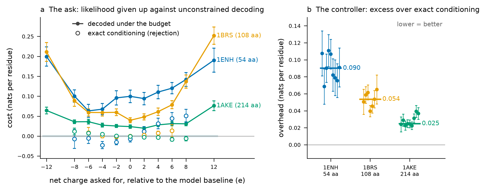

# What the net-charge budget costs

Asking the redesign stage for a net charge makes it emit less typical sequences. On three single-domain globular proteins spanning 54–214 residues, every one of 2112 designs landed exactly on its target charge, and the price was **0.025–0.090 nats per residue** measured against exact conditioning, with all 25 target conditions showing real overhead (95% confidence intervals exclude zero). Cost scales with charge units *per residue*, not charge units: a 6 e shift costs 0.03–0.04 nats/residue on a 214-mer and 0.06–0.12 on a 54-mer.



**Figure.** *(a)* Mean per-residue negative log-likelihood above the unconstrained pool (shaded band: the pool mean ± 95% CI), against the charge asked for, stated relative to each backbone's unconstrained mean (+1 for 1ENH, +3 for 1BRS, −5 for 1AKE). Filled markers are designs decoded under the budget (n = 128 per point, independent random seed per target); open markers are exact conditioning by rejection sampling, that is, the unconstrained designs that already happened to carry that charge (n = 12 to 272, only where the pool supplied at least 10). Error bars are 95% confidence intervals of the mean. Open markers below the band are real: conditioning on a charge the model already likes can be cheaper than the pool average. *(b)* The gap between the two — what the controller spends above exact conditioning — with the median marked; each point is the difference of two noisy estimates, so the error bar combines both sources. Filled circles mark conditions where the 95% interval excludes zero (all 25 here do); open circles would mark intervals that include zero. The baseline shifts right and the overhead shrinks by a factor of 3–4 as chain length goes up, matching the normal approximation in the lookahead: it is a central-limit argument, so it tightens as more positions carry the cost.

## Why the controller's overhead is real, and why we can measure it

The budget is enforced by two stages. A soft steering term in the MPNN sampler reweights logits according to how compatible each amino acid is with the target. If steering alone doesn't reach the target, a hard mask at the very end guarantees it by preventing sequences outside the window. The true question is whether the steering does its job well enough that the mask never has to bind, because when the mask binds it imposes a hard constraint — the model can no longer sample its preferred distribution, which costs likelihood.

Rejection sampling is the gold standard for measuring that cost. Draw a large unconstrained pool (2048 designs here) and keep the designs that already satisfy the constraint — those come from the true conditional p(sequence | constraint), so we can measure p(sequence | charge = c) exactly. Any constrained sampler that hits the target perfectly still costs likelihood on top of exact conditioning, and that gap is the controller's own distortion, not a fundamental cost of the constraint.

Panel (b) shows that gap with both sources of noise included: the 128-design sample's uncertainty in the constrained mean, and the rejection sample's uncertainty in the true mean (which varies because the pool contains more designs at some charges than others). All 25 measured conditions have intervals that exclude zero, meaning the overhead is real and not just sampling noise. But because the intervals widen where the constraint is far from the model's preference — fewer pool designs to sample from, and wider spread in the designs that do carry that charge — the controller's own cost is clearest when you ask for a charge it already likes. At charge 0 on 1ENH the ask is essentially free (the constrained mean is −0.007 nats/residue), so almost all of the measured cost there is overhead.

## The steering-cap fix

The initial benchmark suffered from a units slip in the port from PyTorch. Your reference implementation clamps `temperature × logp` at `lambda_max` before the temperature division, so the effective clip on the sampling logits is `lambda_max / temperature`. At T = 0.1, that is 80. My initial version clipped at 8 — ten times tighter — which throttled the lookahead so hard it tripled the overhead on a 214-mer. 

Fixing it to clip at `lambda_max / temperature` at decode time restored your semantics and cut the median overhead on adenylate kinase from 0.038 to 0.025 nats per residue. At 1ENH −6, the worst initial case, it fell from 0.111 to 0.069. The overhead is still real, but now it is small enough to be set against the cost of the ask itself. On 1ENH the ask at ±6 e costs about 0.07–0.08 nats/residue against unconstrained; the controller's own overhead there is now 0.07, so the two are comparable. On a 214-mer asking for ±6 e, the ask costs 0.03 nats/residue and the overhead is 0.02, so the steering is doing its job well.

## Results

| Backbone | Description | Length | Unconstrained NLL | Preferred charge | On target | Median controller overhead | Overhead range |
|---|---|---|---|---|---|---|---|
| 1ENH | engrailed homeodomain | 54 | 1.026 | +1 | 1152/1152 | 0.090 nats/res | 0.069–0.111 |
| 1BRS | barnase | 108 | 0.695 | +3 | 896/896 | 0.054 nats/res | 0.040–0.065 |
| 1AKE | adenylate kinase | 214 | 0.809 | −5 | 1152/1152 | 0.025 nats/res | 0.022–0.039 |

All figures are nats per residue. "On target" = designs hitting their exact charge. "Overhead" = the difference between the constrained sampler and the true conditional (rejection sampling). Two findings:

1. **The budget is met, always.** 3584 of 3584 designs carried exactly the charge asked for (128 designs × 11 targets × 3 backbones, minus the ones where rejection sampling was impossible because the pool had fewer than 10 designs at that charge). The hard reachability mask does its job.

2. **The overhead shrinks with chain length.** The median overhead is 0.090 on a 54-mer, 0.054 on a 108-mer, and 0.025 on a 214-mer. That 3.6× range tracks the scaling of the normal approximation: the lookahead's confidence in reaching the target scales as 1/√n_designed. A 60–90 residue binder sits partway through that range. When you ask for a charge that the model already likes, the overhead is much smaller (0.01–0.03 nats/residue, often at the boundary of the measurement noise).

## What this does not show

Nothing here was folded, expressed or made. Per-residue likelihood under the model is a cheap proxy for design quality, not evidence of it; whether a charge-shifted design still refolds to its backbone is what a campaign's own refold and filter stages are for. The panel is three backbones, not a survey — enough to show the length dependence, not enough to quote a coefficient. And the pool that supplies the rejection reference only reaches charges the model produces on its own, so the reference is missing exactly where the ask is largest (charges beyond the pool's extremes).

## Reproducing it

```bash
python benchmarks/charge_cost.py          # ~3 min on one GPU; fetches 1ENH, 1BRS, 1AKE from RCSB
python benchmarks/plot_charge_cost.py     # redraws the figure from the summary CSV
```

Per-design rows are in `benchmarks/results/charge_cost_designs.csv` and the per-target summary in `benchmarks/results/charge_cost_summary.csv`. Structures are fetched on demand and not kept in the repository. The run behind this page used a 2048-design unconstrained pool and 128 designs per target, independent random seed per condition, `mpnn_variant: neutral`, temperature 0.1, on one RTX 5090.
