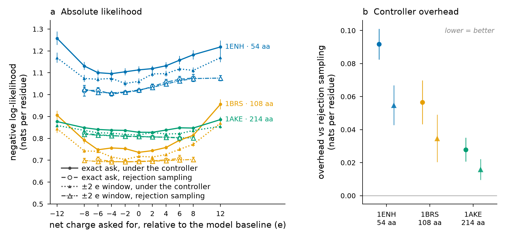

# What a charge tolerance window buys

`mpnn_charge_tolerance` widens the ask from a single net charge to a window. The controller then
has to land the design anywhere in `mpnn_target_charge ± mpnn_charge_tolerance` instead of on one
exact integer, and it should pay less model likelihood for the weaker constraint. This page
measures how much less.

## What was run

`benchmarks/charge_tolerance.py` decodes two arms per charge target on the same three
single-domain backbones used by the charge-cost benchmark, from one shared unconstrained pool per
backbone:

| arm | settings |
| --- | --- |
| exact | `mpnn_target_charge = c`, `mpnn_charge_tolerance = 0` |
| window | `mpnn_target_charge = c`, `mpnn_charge_tolerance = 2` |

Targets are offsets from each backbone's own unconstrained mean charge, because an absolute charge
is not comparable across sizes: a 12 e shift is a large ask on a 54-mer and a small one on a
214-mer. Each arm gets its own rejection-sampling reference drawn from the shared pool — designs at
exactly `c` for the exact arm, designs anywhere in `c ± 2` for the window arm. Rejection sampling
realises the true conditional, so the gap between an arm and its own reference is that arm's
controller overhead rather than the price of asking.

```
python benchmarks/charge_tolerance.py --pool 2048 --n-designs 128 --tolerance 2
python benchmarks/plot_charge_tolerance.py
```

3 backbones x (2048 pool + 11 targets x 2 arms x 128 designs) = 14 592 designs, 3 min 19 s wall on
one GPU. Every number below comes from `benchmarks/results/charge_tolerance_summary.csv`; the
per-design rows are in `charge_tolerance_designs.csv`.

## The result



**The window is cheaper at every single target.** Across all 33 backbone x target combinations the
window arm has lower per-residue negative log-likelihood than the exact arm, with no exceptions
(paired t over the 33 differences, t = -9.19, p = 1.7e-10). Mean saving per backbone:

| backbone | length | window - exact (nats/residue) |
| --- | --- | --- |
| 1ENH engrailed homeodomain | 54 | -0.048 |
| 1BRS barnase | 108 | -0.042 |
| 1AKE adenylate kinase | 214 | -0.016 |

The saving shrinks with chain length, the same way the cost of the exact ask does: a 54-mer has few
positions to spend on a charge demand, so loosening the demand returns more per residue.

**Most of the saving is controller overhead, not the ask.** Measured against each arm's own
rejection-sampling reference, the overhead roughly halves:

| backbone | exact (nats/residue) | window (nats/residue) |
| --- | --- | --- |
| 1ENH | 0.092 +- 0.009 | 0.055 +- 0.012 |
| 1BRS | 0.057 +- 0.013 | 0.035 +- 0.014 |
| 1AKE | 0.028 +- 0.007 | 0.016 +- 0.006 |

Intervals are 95% t intervals over the charge targets that had a usable rejection reference (>= 10
pool designs in the window). Hitting one exact integer forces the controller to steer hard near the
end of the decoding order, where few positions are left to absorb the correction; a window lets it
stop steering as soon as the running charge is inside the band.

**The window is used as a window, not as a soft exact target.** Every design in the window arm
landed inside the band (128/128 at all 33 targets), but only 0 to 31 of 128 landed on the exact
centre, with a within-condition charge spread of 0.25 to 1.58 e. The feature widens the accepted
set rather than aiming at the centre with a wider tolerance for failure.

## Reading this for design work

Ask for a window whenever the downstream requirement is a charge range rather than a number — which
it usually is, since charge enters as a solubility, expression or electrostatic-steering
consideration, not as an exact count. Reserve `mpnn_charge_tolerance = 0` for cases where a
specific net charge is genuinely the specification.

The saving is in model likelihood, which is a proxy for how natural the sequence looks to
ProteinMPNN, not a measurement of folding or binding. It says the window costs less fluency; it
does not say the resulting designs express better.
